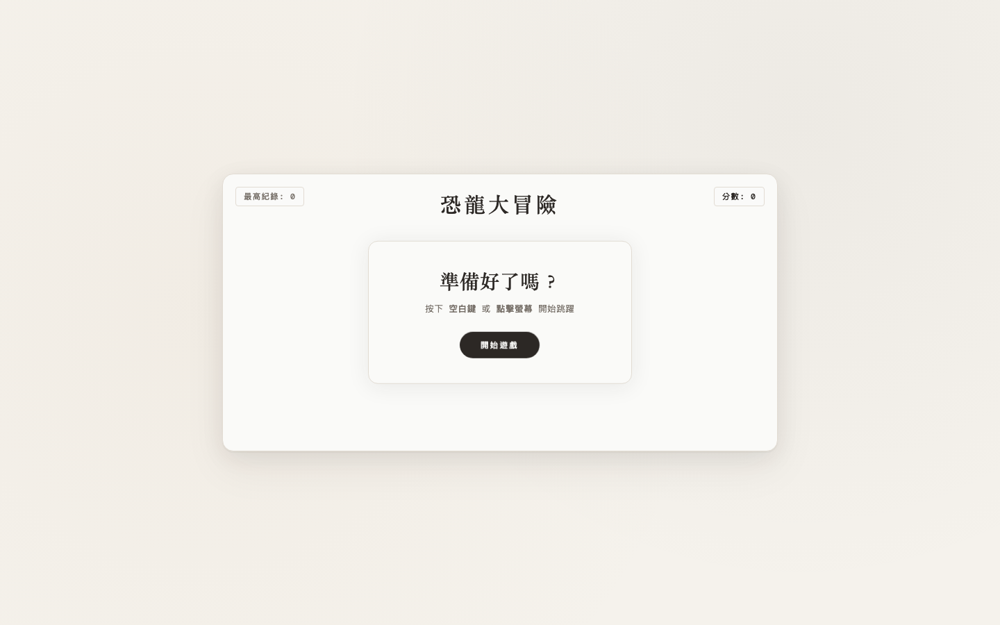

<!-- 本檔由 /sync-docs 自動生成，請勿手動編輯——手改內容下次會被覆蓋。 -->
# 恐龍大冒險 (Dino Adventure)

使用 HTML5 Canvas 開發的網頁恐龍跳躍遊戲，跳過仙人掌、挑戰高分。線上遊玩：https://lingaoscar.github.io/Html-DinoJump/



## 玩法
- 按空白鍵或點擊「開始遊戲」開始；遊戲中按空白鍵或點擊畫面跳躍，可雙跳。
- 撞到仙人掌即結束，分數越高障礙物越快。
- 每累積過 10、20、30… 個障礙物，觸發 5 秒無敵的「飛翔模式」彩蛋。
- 最高分存於瀏覽器 `localStorage`。

## 技術棧
- 純靜態 HTML／CSS／Vanilla JavaScript，Canvas 2D API
- 恐龍與仙人掌以向量繪製，無圖片素材
- 字型：Google Fonts（Playfair Display、DM Mono）

## 快速開始
直接用瀏覽器開啟 `index.html`，或執行 `python -m http.server` 後開啟 http://localhost:8000/。完整開發說明見 [docs/dev.md](docs/dev.md)。

## 目錄結構
```
index.html          # 進入點：canvas + 開始/結束畫面 UI
css/style.css       # 版面與視覺樣式
js/script.js        # 全部遊戲邏輯
doc/                # GitHub Pages 部署說明
docs/               # 開發文件（dev.md）與系統截圖
```
